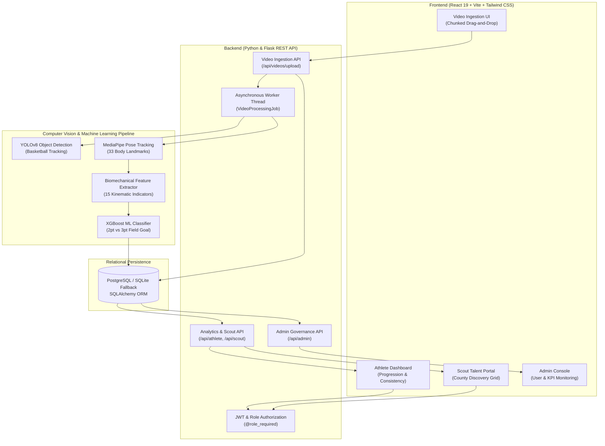

# CourtVision™ - Basketball Talent Identification System

> **Grassroots Computer Vision & Biomechanical Talent Scouting Platform**  
> Developed for the **M-PESA x Jr. NBA Kenya** program as an Informatics and Computer Science capstone project at **Strathmore University**.  
> **Author**: Gloria Khalayi Maloba (Adm: 168878) • **Supervisor**: Kelvin Ouma

---

## 📌 Project Overview

**CourtVision™** is an automated web platform designed to democratize, standardize, and decentralize basketball talent identification in Kenya. Traditionally, talent discovery has been heavily reliant on physical in-person scouting clinics concentrated in major metropolitan hubs (Nairobi), leaving promising prospects in peripheral counties overlooked due to budgetary and logistical barriers.

Using ordinary smartphone video footage, CourtVision™ leverages state-of-the-art computer vision to extract objective shooting biomechanics:
1. **Shooting Angle**: 3-point elbow release angle (Shoulder $\to$ Elbow $\to$ Wrist) measured at ball release.
2. **Jump Height at Ball Release**: Vertical elevation (cm) of hips/ankles scaled to the athlete's physical height.
3. **Shot Type Classification**: Automated categorization into **Two-Point** vs. **Three-Point** attempts using an **XGBoost Classifier** trained on kinematic features.

---

## 🏗️ System Architecture



---

## 🚀 Key Features by User Role

### 1. 🏀 Athlete & Coach Portal
- **Smartphone Video Upload**: Drag-and-drop video upload supporting `.mp4`, `.mov`, `.avi`, and `.webm` up to 500MB.
- **Biomechanical Shot Breakdown**: Review individual shot releases with exact timestamps, elbow release angles, and jump heights.
- **Consistency Rating Badges**: Evaluates form stability based on standard deviation ($\sigma$):
  - 🟢 **Elite Consistency** ($\sigma \le 2.5^\circ$)
  - 🔵 **High Consistency** ($2.5^\circ < \sigma \le 4.0^\circ$)
  - 🟡 **Moderate Consistency** ($4.0^\circ < \sigma \le 6.0^\circ$)
  - 🟠 **Developing Consistency** ($\sigma > 6.0^\circ$)
- **Historical Progression Chart**: Interactive timeline tracking jump height and release angle development over training sessions.

### 2. 🔍 Scout Regional Talent Portal
- **County-by-County Discovery Grid**: Filter prospective talent by Kenyan counties (*Nairobi*, *Kisumu*, *Mombasa*, *Eldoret*, etc.).
- **Multi-Parameter Search**: Filter by playing position, minimum shot repetitions, vertical jump height, or shooting consistency.
- **Scouting Profile Modal**: Instant access to athlete background, verified physical metrics, drill footage replay, and cumulative shot charts.

### 3. ⚙️ System Administration Console
- **System KPI Metrics**: Real-time monitoring of registered athletes/scouts, stored drill footage, and pipeline throughput.
- **User Directory Governance**: Full user search, role filtering, and account moderation.

---

## 👥 Pre-Seeded Demo Accounts for Fast Testing

| Role | Email | Password | Details |
| :--- | :--- | :--- | :--- |
| **Athlete** | `athlete@courtvision.ke` | `password123` | Kevin Otieno (Kisumu County, Shooting Guard, 188cm) |
| **Scout** | `scout@courtvision.ke` | `password123` | Coach Achieng (M-PESA x Jr. NBA Regional Scout) |
| **Admin** | `admin@courtvision.ke` | `adminpassword123` | Gloria Maloba (System Administrator) |

---

## 🛠️ Getting Started & Installation

You can run CourtVision™ either via **Docker Compose** (recommended for production) or **Manual Local Setup** (recommended for active development).

### Option A: Docker Compose Deployment (Recommended)

Requires [Docker Desktop](https://www.docker.com/products/docker-desktop) installed.

```bash
# 1. Clone repository
git clone https://github.com/GloriaKMaloba/CourtVision.git
cd CourtVision

# 2. Copy environment template
cp .env.example .env

# 3. Build and launch all services (PostgreSQL + Flask Backend + React Frontend)
docker compose up --build
```

- **Frontend Application**: `http://localhost:5173` (or `http://localhost`)
- **Backend REST API**: `http://localhost:5000/api`
- **PostgreSQL Database**: Port `5432`

---

### Option B: Manual Local Setup (Development)

#### 1. Backend Setup (Flask + SQLite/Postgres)
```bash
# Navigate to backend directory
cd backend

# Create and activate Python virtual environment
# Windows (PowerShell):
python -m venv venv
.\venv\Scripts\Activate.ps1

# Linux / macOS:
# python3 -m venv venv && source venv/bin/activate

# Install required packages
pip install -r requirements.txt

# Seed database with demo accounts & sample profiles
python seed.py

# Start Flask development server (runs on port 5000)
python run.py
```

#### 2. Frontend Setup (React + Vite)
```bash
# Open a new terminal and navigate to frontend directory
cd frontend

# Install npm packages
npm install

# Start Vite development server (runs on port 5173 with proxy to backend)
npm run dev
```

Visit **`http://localhost:5173`** in your browser.

---

## 🧪 Automated Testing Suite

CourtVision™ includes a comprehensive test suite covering API contracts, unit math, ML classifier robustness, resilience against bad video inputs, and latency benchmarks.

```bash
# From the project root
$env:PYTHONPATH="backend"
backend\venv\Scripts\python.exe -m unittest discover -s backend/tests -p "test_*.py"
```

### Test Suite Coverage:
- `backend/tests/test_api.py`: Core authentication and multipart upload endpoints.
- `backend/tests/test_cv_pipeline.py`: MediaPipe landmark vector math, elbow angle, and trunk lean formulas.
- `backend/tests/test_classification_persistence.py`: XGBoost inference, missing-landmark robustness, and database persistence.
- `backend/tests/test_analytics_api.py`: Metrics aggregation, session timeline calculation, and scout filtering.
- `backend/tests/test_e2e_integration.py`: End-to-end HTTP integration, corrupted video error handling, and latency benchmarking (average ~4.4ms per shot analysis).

---

## 📚 Project Documentation

- **[Cloud Deployment & Domain Setup Guide](docs/DEPLOYMENT_GUIDE.md)**: 1-Click Render cloud deployment, custom domain setup (`courtvision.ke`), and live production checklist.
- **[REST API Specification](docs/API_SPECIFICATION.md)**: Full endpoint reference, request/response payloads, and status codes.
- **[User Walkthrough Guide & SOP](docs/USER_GUIDE.md)**: Smartphone camera recording standards, athlete drill guidelines, and scout discovery manual.

---

## 📄 License & Academic Declaration

This project was developed by **Gloria Khalayi Maloba** (Admission No. **168878**) in partial fulfillment of the requirements for the award of a Bachelor of Science in Informatics and Computer Science at **Strathmore University**, School of Computing and Engineering Sciences, Nairobi, Kenya.

All rights reserved © 2026 CourtVision™.
